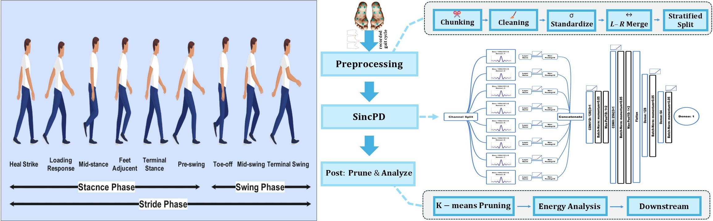
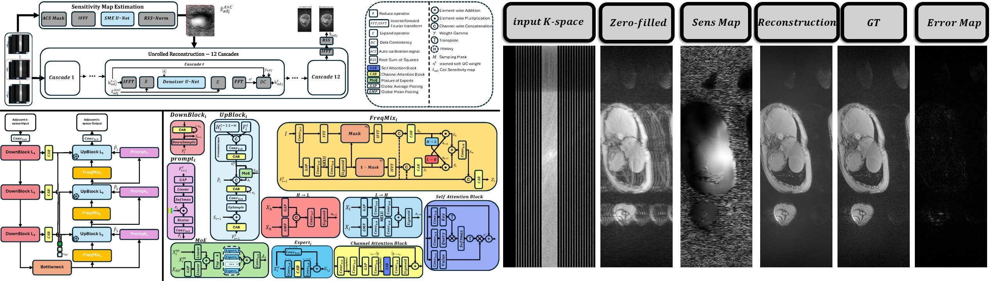
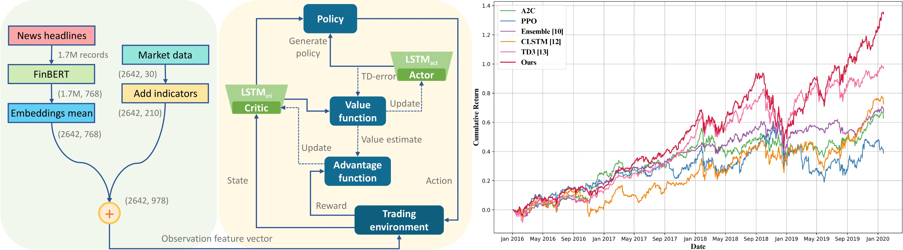
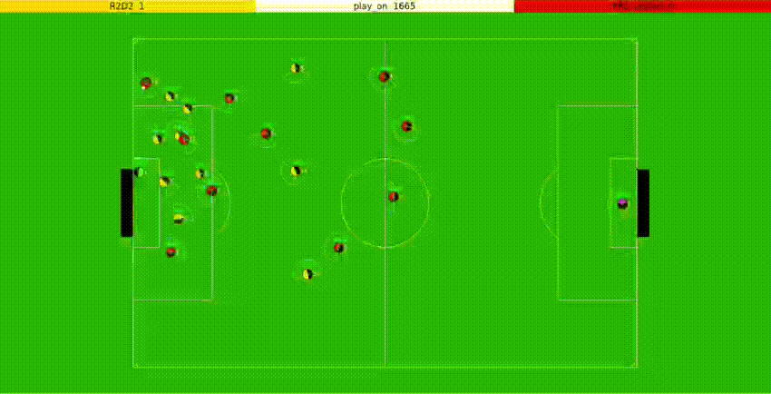

## Conference and Journal Papers

<section class="pub-grid">
  <!-- SINCNET -->
  <article class="pub-card">
    

      
      Discover Artificial Intelligence (Springer) 2026
    

    

      <header class="pub-head">
        <h3 class="pub-title">An Explainable Method Based on Sinc Filters to Diagnose Parkinson’s Disease Severity by Gait Cycle Analysis</h3>
        

          <a class="icon-btn" href="https://doi.org/10.1007/s44163-026-01993-8" title="Published paper (Springer, open access)" aria-label="Journal article"><i class="fas fa-book-open"></i></a>
          <a class="icon-btn" href="https://www.arxiv.org/abs/2502.17463" title="Preprint (arXiv)" aria-label="PDF"><i class="far fa-file-pdf"></i></a>
          <a class="icon-btn" href="https://github.com/MahanVeisi8/Explainable-PD-Diagnosis-using-SincNet-and-Gait-Analysis" title="GitHub" aria-label="GitHub"><i class="fab fa-github"></i></a>
        

      </header>

      

        <a href="https://scholar.google.com/citations?user=akmKmMQAAAAJ&hl=en"><i class="ai ai-google-scholar"></i> Armin Salimi-Badr</a>,
        <strong>Mahan Veisi</strong>, Sadra Berangi
      

      

        
Read more

        

          

            <strong>SincPD</strong>, published open access in <em>Discover Artificial Intelligence</em> (Springer), 6(1), 2026. Adaptive Sinc-based bandpass filters learn informative frequency bands directly from raw vertical ground-reaction-force gait signals, reaching <strong>98.77% accuracy</strong> for diagnosis and <strong>97.22%</strong> for severity assessment. K-means clustering and silhouette scores prune the filter bank from 800 filters down to 30 with negligible loss, so the frequency bands driving each decision stay inspectable.
          

        

      

    

  </article>

  <!-- MRI RECON -->
  <article class="pub-card">
    

      
      Presented at ISMRM 2026
    

    

      <header class="pub-head">
        <h3 class="pub-title">AdaptCMR: All-in-One MRI Reconstruction with Cascaded Transformers</h3>
        

          <a class="icon-btn" href="https://echo.ismrm.org/abstracts/view/6b41d73e-84c9-451a-bc7f-6b4d26b1e718" title="Paper (PDF)" aria-label="PDF"><i class="far fa-file-pdf"></i></a>
          <a class="icon-btn" href="https://github.com/MahanVeisi8/SpectraMR" title="GitHub" aria-label="GitHub"><i class="fab fa-github"></i></a>
        

      </header>

      

        <strong>Mahan Veisi</strong>
        <a href="https://scholar.google.com/citations?user=D_mPA6sAAAAJ&hl=en"><i class="ai ai-google-scholar"></i> Kian Anvari</a>
        <a href="https://scholar.google.com/citations?user=gHVVhW4AAAAJ&hl=en"><i class="ai ai-google-scholar"></i> Shahabedin Nabavi</a>
      

      

        
Read more

        

          

            AdaptCMR is a parameter-efficient, detail-preserving deep learning framework for cardiac MRI reconstruction. It uses a spectrally guided mixture of experts to generalize across different views, contrasts, and acceleration factors, preserving fine anatomical detail with fewer parameters and faster inference.
          

        

      

    

  </article>

  <!-- DRL TRADING -->
  <article class="pub-card">
    

      
      IEEE ICCKE 2024
    

    

      <header class="pub-head">
        <h3 class="pub-title">Deep Reinforcement Learning for Stock Trading</h3>
        

          <a class="icon-btn" href="https://ieeexplore.ieee.org/document/10874515" title="Paper (PDF)" aria-label="PDF"><i class="far fa-file-pdf"></i></a>
          <a class="icon-btn" href="https://github.com/MahanVeisi8/LSTMppo-DRL-StockTrader" title="GitHub" aria-label="GitHub"><i class="fab fa-github"></i></a>
          <a class="icon-btn" href="https://youtu.be/Jfpc6_kGLYo?si=U9xVX03Jn_7jxY1d" title="YouTube" aria-label="YouTube"><i class="fab fa-youtube"></i></a>
        

      </header>

      

        <strong>Mahan Veisi</strong>, Sadra Berangi
        <a href="https://scholar.google.com/citations?user=QufpdNgAAAAJ&hl=en"><i class="ai ai-google-scholar"></i> Mahdi Shahbazi Khojasteh</a>
        <a href="https://scholar.google.com/citations?user=akmKmMQAAAAJ&hl=en"><i class="ai ai-google-scholar"></i> Armin Salimi-Badr</a>
      

      

        
Read more

        

          

            Integrated FinBERT, a financial sentiment analysis LLM, to extract sentiment from news and combined it with stock prices in a PPO-LSTM model for stock trading. Achieved <strong>134.39% cumulative return</strong> (2.34× initial budget) and a <strong>1.46 Sharpe ratio</strong>, significantly outperforming DJIA, Ensemble, and PPO models.
          

        

      

    

  </article>

  <!-- ROBOCUP (title + short readmore only) -->
  <article class="pub-card">
    

      
      RoboCup Proc.
    

    

      <header class="pub-head">
        <h3 class="pub-title">Intelligent Agents for RoboCup Soccer Simulation</h3>
        

          <a class="icon-btn" href="https://archive.robocup.info/Soccer/Simulation/2D/TDPs/RoboCup/2023/R3CESBU_SS2D_RC2023_TDP.pdf" title="Paper (PDF)" aria-label="PDF"><i class="far fa-file-pdf"></i></a>
        

      </header>

      

        
Read more

        

          

            Role-optimized agents (goalkeeping, defense, teamwork) in the 2D Simulation League; team placed 2nd at IranOpen 2023.
          

        

      

    

  </article>
</section>
